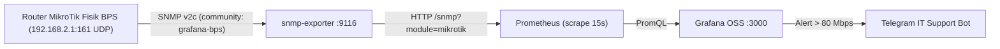

# PROGRESS.md – Status Monitoring Stack PT Baja Perkasa Sentosa

Status Terakhir: **Aktif & Terverifikasi (Production Mode / Router Fisik PT Baja Perkasa Sentosa)**  
Diperbarui oleh: **Romi (Senior DevOps Engineer)**  
Tanggal: **12 November 2026**

---

## 1. Ringkasan Sistem Saat Ini

Stack monitoring difokuskan penuh untuk **Analisa & Monitoring Router MikroTik Fisik Kantor (RB5009UG+S+)** secara riil dan live:

| Service | Container Name | Image Version | Port Binding | Status |
|---|---|---|---|---|
| **Prometheus** | `prometheus` | `prom/prometheus:v3.2.1` | `0.0.0.0:9090` | ✅ Up & Scraping (15s) |
| **SNMP Exporter** | `snmp-exporter` | `prom/snmp-exporter:v0.26.0` | Internal (`9116`) | ✅ Up |
| **Grafana OSS** | `grafana` | `grafana/grafana:11.5.2` | `0.0.0.0:3000` | ✅ Up & Healthy |
| **Router Fisik MikroTik** | `192.168.2.1:161` | `RouterOS 7.22.2 (RB5009)` | `UDP 161` | ✅ Up & Streaming Real Metrics |

*(Seluruh simulator dummy dan script pengacak nilai telah dihapus permanen demi efisiensi dan keamanan sistem produksi).*

---

## 2. Arsitektur & Fitur Monitoring Produksi

### A. Alur Pengumpulan Metrik Jaringan

### B. Interface Fisik PT Baja Perkasa Sentosa yang Termonitor:
- **`ether1-WAN1`** (ISP Utama - Trafik Terakumulasi > 18.3 TB)
- **`ether2-WAN2`** (ISP Cadangan)
- **`ether3-LAN-Office`** (Jaringan Kantor Pusat - Trafik Terakumulasi > 2.2 TB)
- **`ether4-CCTV`** (Jaringan Kamera Keamanan Pabrik)
- **`ether5-SAP`** (Server ERP SAP Manufaktur)
- **`ether6-MES`** (Manufacturing Execution System)
- **`ether7`** & **`ether8-Config`** (Port Manajemen & Cadangan)
- **`sfp-sfpplus1`** (Uplink Fiber Optic 10G)
- **`wg-bps`** (VPN WireGuard Antar-Site BPS)

### C. Dashboard MikroTik Modern & Full Advanced
1. **MikroTik Router Monitoring (Overview):** Banner hijau identitas RouterOS, gauge CPU & RAM, stat uptime, grafik tren CPU history, memory used vs free, status port table, traffic RX/TX gelombang, dan packet rate.
2. **MikroTik Monitoring (Full Advanced 40 Panel):** 100% identik dengan standar referensi BPS mencakup metrik SNMP, Error counters, Neighbors, Simple Queue, Tree Queue, serta statistik paket jaringan.

### D. Auto-Provisioning Alerting Telegram
- Rule lonjakan bandwidth `ether1` **> 80 Mbps** aktif di scheduler Grafana (`for: 30s`).
- Target query PromQL menggunakan label `ifName=~"ether1.*"`.
- Format pesan Telegram dirapikan secara profesional menggunakan pemisah rapi, emoji indikator (🚨 / ✅), ringkasan detail unduhan, batas aman, rekomendasi tindakan IT Support, serta direct link ke dashboard.
- Rute koneksi Telegram dikunci menggunakan IPv4 langsung di `docker-compose.yml` (`extra_hosts`) untuk mencegah *timeout* IPv6.

---

## 3. Checklist Validasi & Quality Gates

- [x] **Docker Compose Syntax:** Valid (`docker compose config --quiet`).
- [x] **Prometheus Configuration Syntax:** Valid (`promtool check config` $\rightarrow$ `SUCCESS`).
- [x] **Koneksi Router MikroTik Produksi:** 100% aktif dan sehat (`health: up`, IP `192.168.2.1:161`, auth `grafana_bps`).
- [x] **Dummy Components Removed:** Folder `dummy-snmp` dan seluruh konfigurasi dummy simulator telah dibersihkan.
- [x] **Grafana JSON Syntax:** Semua file `.json` valid sintaks JSON tanpa error schema.
- [x] **Kredensial Grafana:** Teruji dan aktif (`admin` / `Admin123!`).
- [x] **Folder Dashboards Bersih:** Folder kosong `MikroTik Alerts` telah dihapus; aturan alert disatukan ke dalam folder `Infrastructure` bersama dashboard.
- [x] **PromQL Queries:** 100% valid membaca data real-time router RB5009.
- [x] **Live Streaming Timeseries:** Mengalir secara *real-time* dengan `liveNow: true` dan interval refresh 5s.
- [x] **Single Streamlined Dashboard:** Dashboard lama `MikroTik Router Monitoring` telah dihapus; kini hanya menggunakan 1 dashboard utama `MikroTik Monitoring (Full Advanced)` yang telah dirapikan (menghapus seluruh panel No Data seperti Wireless, CAPsMAN, W60G, Modem, Queue, dan POE).
- [x] **SNMP Timeout Hardened:** Scrape timeout disetel ke 25s dan interval 30s untuk menjamin walk SNMP stabil tanpa *context deadline exceeded*.
