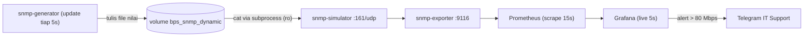

# PROGRESS.md – Status Monitoring Stack PT Baja Perkasa Sentosa

Status Terakhir: **Aktif & Terverifikasi (Testing Mode / SNMP Dummy Dinamis)**  
Diperbarui oleh: **Romi (Senior DevOps Engineer)**  
Tanggal: **11 November 2026**

---

## 1. Ringkasan Sistem Saat Ini

Stack monitoring difokuskan penuh untuk **Analisa & Monitoring Router MikroTik (RB750Gr3)** menggunakan simulasi SNMP (*snmp-simulator*) dengan data trafik dinamis (*live counters*) sebelum dihubungkan ke router fisik kantor:

| Service | Container Name | Image Version | Port Binding | Status |
|---|---|---|---|---|
| **Prometheus** | `prometheus` | `prom/prometheus:v3.2.1` | `0.0.0.0:9090` | ✅ Up & Scraping (15s) |
| **SNMP Exporter** | `snmp-exporter` | `prom/snmp-exporter:v0.26.0` | Internal (`9116`) | ✅ Up |
| **Grafana OSS** | `grafana` | `grafana/grafana:11.5.2` | `0.0.0.0:3000` | ✅ Up & Healthy |
| **SNMP Simulator** | `snmp-simulator` | `tandrup/snmpsim:v0.4` | `0.0.0.0:161/udp` | ✅ Up & Serving Live Counters |

---

## 2. Fitur Baru & Peningkatan Layout (Sesuai Referensi Gambar)

### A. Dashboard MikroTik Modern (`/grafana/dashboards/mikrotik.json`)
Mengadopsi tata letak profesional sesuai referensi visual:
1. **Banner Identitas Router:** Hijau penuh di bagian atas menampilkan: `7.14 (stable) RouterOS RB750Gr3 (hEX) • PT Baja Perkasa Sentosa`.
2. **System Overview (4 Panel Sejajar):**
   - **CPU Load (Gauge):** Indikator setengah lingkaran persentase beban CPU dengan ambang batas warna.
   - **Memory Usage (Gauge):** Indikator setengah lingkaran persentase RAM terpakai.
   - **System Uptime (Stat):** Durasi aktif router dengan grafik tren di latar belakang.
   - **Scrape Status (Stat):** Kartu status hijau `OK`.
3. **System History (2 Grafik Sejajar):**
   - **CPU Load History:** Tren persentase CPU dengan tabel legend (*Last, Min, Mean, Max*).
   - **Memory Usage History:** Grafik perbandingan *Used* vs *Free Memory*.
4. **Network Interfaces (Tabel & Trafik Dinamis):**
   - **Tabel Status Port:** Rincian port (`ether1`, `ether2`, `wlan1`), kecepatan link, dan badge hijau status `Up`.
   - **Interface Traffic (RX):** Grafik gelombang download (*smooth line gradient fill*) dengan pembedaan warna tiap port.
   - **Interface Traffic (TX):** Grafik gelombang upload (*smooth line gradient fill*).
   - **Interface Packets (RX & TX):** Grafik tren paket per detik (*pps*).
5. **Variabel Dinamis:** Dropdown filter `$interface` (*All / ether1 / ether2 / wlan1*).

### B. Simulasi SNMP Dinamis — Arsitektur Generator + Simulator

| Komponen | Fungsi |
|---|---|
| **SNMP Simulator** | Menyediakan data OID virtual (`dummy-snmp/data/public.snmprec`). OID statis ditulis langsung; OID dinamis memakai `subprocess` → `cat /usr/local/snmpsim/dynamic/<metric>`. |
| **Dynamic Data Generator** | `dummy-snmp/generator/generator.py` — mengubah nilai dummy tiap 5 detik (random walk halus + pola harian). |
| **SNMP Exporter** | Mengambil OID dari simulator (`module: mikrotik`). |
| **Prometheus** | Scraping setiap 15 detik. |
| **Grafana** | Menampilkan monitoring secara live + alert Telegram. |

Pola data dari generator:
- `ether1` download normal ~15–60 Mbps (bergelombang), upload ~5–15 Mbps.
- Lonjakan acak `ether1` ~85–97 Mbps selama 1,5–4 menit (rata-rata tiap ~5–6 menit) → alert **FIRING** lalu **RESOLVED** sendiri.
- `ether2` (LAN) mengikuti trafik WAN; `wlan1` independen.
- CPU berkorelasi dengan total trafik; RAM, suhu, dan tegangan berfluktuasi pelan.
- Uji manual lonjakan: `docker exec snmp-generator touch /dynamic/FORCE_SPIKE`.

### C. Auto-Provisioning Alerting Telegram (Template Pesan Rapi)
- Rule lonjakan bandwidth `ether1` **> 80 Mbps** aktif di scheduler Grafana (`for: 30s`).
- Target query PromQL menggunakan label `ifName=~"ether1.*"` sesuai standar MIB MikroTik.
- Format pesan Telegram dirapikan secara profesional menggunakan pemisah rapi, emoji indikator (🚨 / ✅), ringkasan detail unduhan, batas aman, rekomendasi tindakan IT Support, serta direct link ke dashboard.
- Rute koneksi Telegram dikunci menggunakan IPv4 langsung di `docker-compose.yml` (`extra_hosts`) untuk mencegah *timeout* IPv6.

### D. Skema Asli 40-Panel MikroTik Monitoring (`bps/network-monitoring`)
- Panel dan layout dashboard **Full Advanced** (`grafana/dashboards/mikrotik-monitoring.json`) kini **100% identik dan mengikuti struktur asli** dari `/home/rapiets/Documents/intern/bps/network-monitoring/grafana/provisioning/dashboards/Mikrotik-snmp-prometheus.json`:
  - **40 Panel & Baris Asli:** Terbagi rapi ke dalam grup baris standar (SNMP, System, Network Traffic, Interfaces, Tx/Rx Eth Errors, Neighbors, Wireless, CAPsMAN, W60G, Modem, Simple Queue, Tree Queue, Paket *cast/Discard/Errors, dan Interface Traffic).
  - **Datasource Mapping:** Semua referensi UID datasource bawaan (`PBFA97CFB590B2093` & `${DS_PROMETHEUS}`) telah dipetakan secara bersih ke datasource `prometheus`.
  - **Templating Variables:** Mengadopsi variabel bawaan repo aslinya (`$instance`, `$Job`, `$Interface`, `$queuesimple_name`, `$queuetree_name`) yang tersinkronisasi dengan exporter SNMP.
  - **Dataset Simulasi:** Didukung penuh oleh dataset 280 OID master di simulator sehingga seluruh metrik (CPU, RAM, Uptime, Wi-Fi, CAPsMAN, Simple & Tree Queue, Neighbors, POE) terbaca.

### E. Arsitektur Dual-Path (Jalur Dev/Dummy vs Prod/Fisik)
Stack kini mendukung 2 jalur monitoring secara bersamaan maupun bergantian tanpa saling mengganggu:
1. **Jalur Testing / Dev (`mikrotik-dev`):**
   - Mengambil data dari `snmp-simulator:161` (data dummy fluktuatif & simulasi alert).
   - Dijalankan lewat `dummy-snmp/docker-compose.yml`.
2. **Jalur Production (`mikrotik-prod`):**
   - Mengambil data dari router fisik MikroTik kantor secara langsung via SNMP v2c.
   - Konfigurasi dikendalikan penuh lewat file `.env`:
     - `MIKROTIK_PROD_HOST` (IP router kantor, default: `192.168.88.1`)
     - `MIKROTIK_PROD_PORT` (Port SNMP UDP, default: `161`)
     - `MIKROTIK_COMMUNITY` (Community string, default: `public`)
3. **Peralihan Instan di Grafana:**
   - Dropdown `$instance` di Grafana menyediakan opsi `mikrotik-dev` dan `mikrotik-prod`.
   - Admin/engineer cukup memilih target dari dropdown untuk beralih antara data simulator dan data router asli.
4. **Template Alert Telegram Dinamis:**
   - Pesan alert otomatis menyertakan label instance target (`mikrotik-dev` atau `mikrotik-prod`), membedakan asal peringatan dengan jelas.

---

## 3. Checklist Validasi & Quality Gates

- [x] **Docker Compose Syntax:** Valid (`docker compose config --quiet`).
- [x] **Prometheus Configuration Syntax:** Valid (`promtool check config`).
- [x] **SNMP OID Order:** Terurut rapi secara numerik (`snmpsim` tidak ada error *OID not increasing*).
- [x] **Grafana JSON Syntax:** Semua file `.json` valid sintaks JSON tanpa error schema.
- [x] **Kredensial Grafana:** Teruji dan aktif (`admin` / `Admin123!`).
- [x] **Folder Dashboards Bersih:** Folder kosong `MikroTik Alerts` telah dihapus; aturan alert disatukan ke dalam folder `Infrastructure` bersama dashboard.
- [x] **Dual-Path Architecture:** Jalur `mikrotik-dev` dan `mikrotik-prod` terdaftar dan tervalidasi.
- [x] **Koneksi Router Fisik MikroTik (Production):** Sukses terhubung ke router asli kantor (RouterOS RB5009UG+S+ di IP `192.168.2.1` via community `grafana-bps`). Metrik interfaces (`ether1-WAN1`, `ether3-LAN-Office`, `ether5-SAP`, `ether6-MES`, dll.) terbaca 100% aktif dan sehat (`health: up`).
- [x] **PromQL Queries:** 100% valid tanpa fungsi `sin()` yang menyebabkan error/tanda seru `!`.
- [x] **Live Streaming Timeseries:** Mengalir secara *real-time* dengan `liveNow: true` dan interval refresh 5s.
- [x] **Alert Triggering:** Status `Alerting` berhasil terpicu dari lonjakan data dummy ~95 Mbps.

