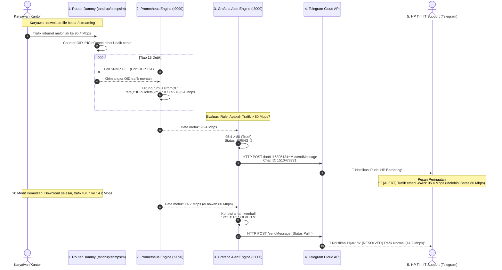

# Skema Alur Deteksi & Alert Trafik Tinggi (SNMP Dummy ➔ Telegram)

Dokumen ini menjelaskan alur teknis bagaimana sistem mendeteksi lonjakan trafik internet pada router MikroTik (menggunakan simulator dummy) dan secara otomatis mengirim pesan peringatan darurat ke Telegram HP Tim IT.

---

## 1. Gambar Diagram Alur

*(File gambar resolusi tinggi tersedia di [`high-traffic-alert-schema.png`](./high-traffic-alert-schema.png) dan versi vektor di [`high-traffic-alert-schema.svg`](./high-traffic-alert-schema.svg))*

---

## 2. Diagram Urutan Kejadian (Sequence Diagram)

---

## 3. Penjelasan Rumus Deteksi Trafik (PromQL)

Grafana dan Prometheus mendeteksi kecepatan download dengan rumus matematika:

$$\text{Kecepatan (Mbps)} = \frac{\text{rate}(ifHCInOctets[2m]) \times 8}{1.000.000}$$

* **`ifHCInOctets`**: Counter standar SNMP 64-bit yang menghitung jumlah byte data yang masuk ke port router.
* **`rate(...[2m])`**: Menghitung rata-rata kenaikan byte per detik selama 2 menit terakhir.
* **`x 8`**: Mengubah satuan **Byte** menjadi **Bit** (karena 1 Byte = 8 Bit).
* **`/ 1.000.000`**: Mengubah satuan Bit menjadi **Megabit per second (Mbps)**.

---

## 4. Siklus Status Alert (*Alert Lifecycle*)

1. **Normal (Hijau):** Trafik di bawah 80 Mbps (misal: 15 Mbps). Tidak ada pesan yang dikirim.
2. **Pending (Kuning):** Trafik tiba-tiba melonjak ke 95 Mbps. Sistem menunggu selama 1 menit untuk memastikan ini bukan hanya lonjakan sesaat (*spike* 1 detik).
3. **Firing (Merah):** Jika dalam 1 menit trafik tetap di atas 80 Mbps, Grafana langsung mengirim pesan darurat ke Telegram HP kamu.
4. **Resolved (Hijau):** Begitu pemakaian bandwidth mereda di bawah 80 Mbps, Grafana otomatis mengirim pesan bahwa kondisi jaringan sudah pulih.

